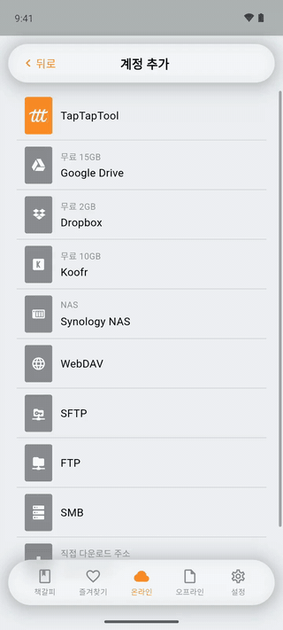
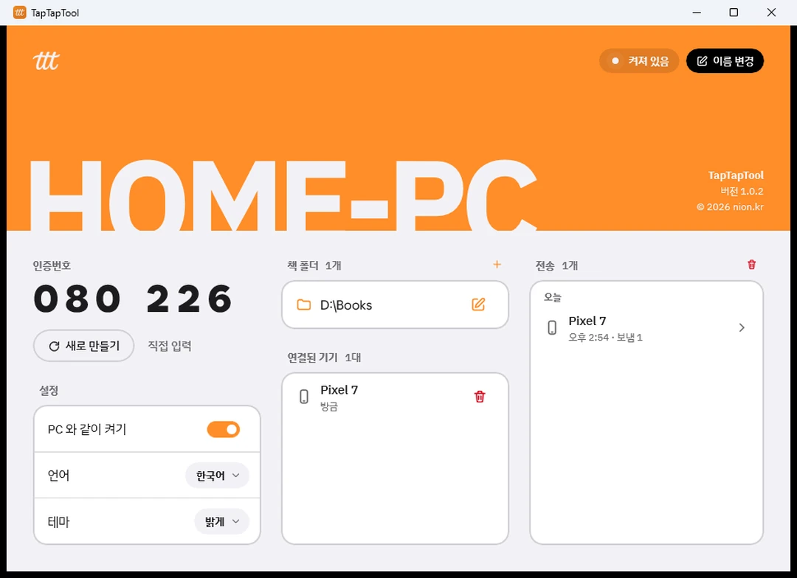
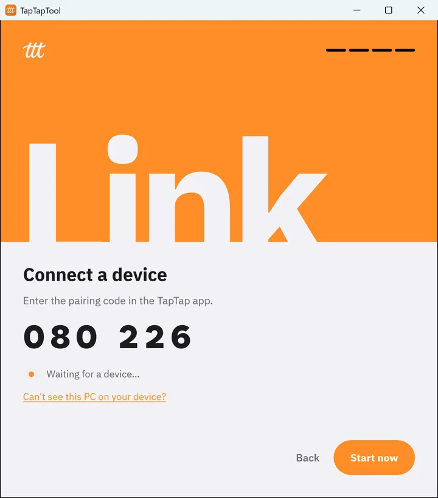
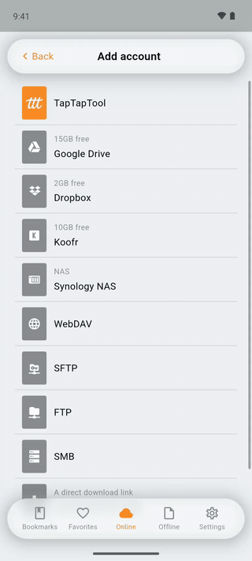
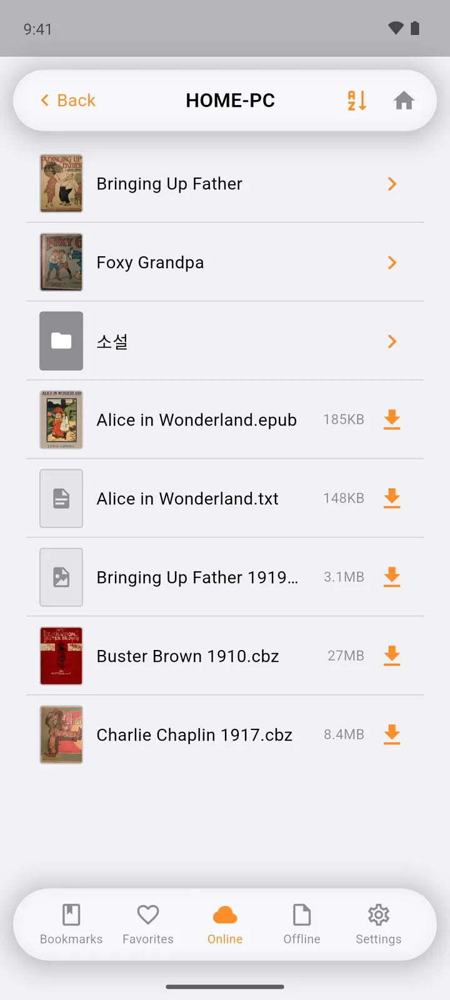

# TapTapTool

[한국어](#user-content-ko) / [English](#user-content-en) / [日本語](#user-content-ja) / [繁體中文](#user-content-zh) / [Español](#user-content-es) / [Português](#user-content-pt) / [Deutsch](#user-content-de) / [Français](#user-content-fr)

PC 에 둔 만화책, 소설을 같은 와이파이의 폰, 태블릿에서 받는 프로그램입니다.
만화, 소설 뷰어 [TapTap](https://nion.kr/apps/taptap) 의 '내 PC'와 함께 씁니다.

- 케이블도 클라우드도 필요 없습니다. 같은 와이파이면 됩니다.
- 광고, 계정, 서버가 없습니다. 인터넷으로는 새 버전 확인만 하고, 책은 PC 에서 기기로만 갑니다.
- 연결은 암호화되고, 인증번호로 페어링 된 기기만 받을 수 있습니다.

---

## 필요한 것

| | |
|---|---|
| PC | Windows 10 / 11 (64비트) / macOS 13 이상(Apple 실리콘 / Intel) |
| 기기 | TapTap **0.7.0 이상** - [Google Play](https://play.google.com/store/apps/details?id=kr.nion.taptap) / App Store |
| 네트워크 | PC 와 기기가 **같은 와이파이**(같은 공유기) |

## 설치 - Windows

1. [Releases](../../releases) 에서 `TapTapTool-windows-x64-<버전>.zip` 을 받습니다.
2. 아무 곳에나 압축을 풉니다(예: `문서\TapTapTool`). 설치 과정은 없습니다.
3. 폴더 안의 `TapTapTool.exe` 를 실행합니다.

**'Windows 의 PC 보호' 창이 뜨면** - '추가 정보' → '실행'을 누르세요.
아직 코드 서명을 하지 않은 프로그램이라 뜨는 창입니다.

**방화벽 창이 뜨면** - **'개인'과 '공용'을 모두 체크**하고 '액세스 허용'을 누르세요.
집 와이파이가 '공용'으로 잡혀 있는 PC 가 많아서, '개인'만 허용하면 기기에서 PC 가 안 보일 수 있습니다.

## 설치 - Mac

1. [Releases](../../releases) 에서 `TapTapTool-macos-<버전>.dmg` 를 받아 엽니다.
2. TapTapTool 을 **'응용 프로그램' 폴더로 끌어다 놓습니다.**
3. 응용 프로그램에서 TapTapTool 을 실행합니다. Apple 의 공증을 받은 프로그램이라 경고 없이 열립니다.

**'들어오는 네트워크 연결을 허용하겠습니까?'가 뜨면** - '허용'을 누르세요. 맥 방화벽을 켜 둔 경우에만 뜹니다.

## 첫 실행

네 단계를 지나면 끝납니다.

1. **언어** - 한국어 / English / 日本語 / 繁體中文 / Español / Português / Deutsch / Français. 나중에 설정에서도 바꿀 수 있습니다.
2. **책 폴더** - 기기에서 둘러볼 폴더를 지정합니다. 폴더는 나중에 더 추가할 수 있습니다.
3. **PC 와 같이 켜기**(Mac 은 **맥과 같이 켜기**) - 켜 두면 PC 만 켜도 바로 받을 수 있습니다. 트레이(Mac 은 메뉴 막대)에서 조용히 실행됩니다.
4. **기기 연결** - 여섯 자리 인증번호가 보입니다. 이 화면을 띄운 채로 기기에서 연결합니다(아래).
   연결은 나중에 해도 됩니다 - '바로 시작하기'.

## 기기에서 연결하기

1. TapTap 앱 › **온라인** 탭 › 오른쪽 위 **+** › **TapTapTool**
2. 앱이 같은 와이파이의 PC 를 찾습니다(수 초 내). 찾은 PC 를 누릅니다.
3. PC 화면의 **인증번호 여섯 자리**를 넣습니다.

이제 온라인 탭에 PC 가 생깁니다. 누르면 책 폴더를 둘러보고, 파일이나 폴더째 받을 수 있습니다.
표지도 PC 에서 바로 보입니다. 받은 책은 기기의 서재 폴더에 들어갑니다.

 &nbsp; 

- 기기는 몇 대든 연결할 수 있습니다. 모든 기기가 같은 인증번호를 씁니다.
- 앱 하나에 PC 를 여러 대 연결할 수도 있습니다.
- 아이폰은 처음 찾을 때 '로컬 네트워크' 허용을 묻습니다 - **허용**을 눌러야 PC 를 찾습니다.

## 대시보드

| 칸 | 할 수 있는 것 |
|---|---|
| 헤더 | PC 이름 / **이름 변경**(비우면 컴퓨터 이름을 씁니다) |
| 인증번호 | **새로 만들기** / **직접 입력** - 바꿔도 이미 연결된 기기는 끊기지 않습니다 |
| 책 폴더 | **추가** / **변경** / **빼기**. 둘 이상이면 기기 첫 화면에 폴더가 줄로 섭니다 |
| 연결된 기기 | 마지막 연결 시각 / **해제** - 다시 연결하려면 인증번호가 필요합니다 |
| 설정 | PC(맥)와 같이 켜기 / 언어 / 테마 |
| 전송 | 기기가 받은 것이 날짜, 기기별로 보입니다(30일). **이력 지우기**로 지웁니다 |

**창을 닫아도 꺼지지 않습니다** - 트레이(Mac 은 메뉴 막대)로 들어가 계속 돕니다.
- Windows: 트레이 아이콘을 누르면 창이 다시 열리고, 오른쪽 클릭 › **끝내기**로 완전히 끕니다.
- Mac: 메뉴 막대 아이콘 › **열기** / **끝내기**. 창이 떠 있을 때는 ⌘Q 로도 끕니다.

## 기기에서 PC 가 안 보일 때

| 확인할 것 | |
|---|---|
| TapTapTool 이 켜져 있나요? | 트레이(Mac 은 메뉴 막대)에 아이콘이 있는지 봅니다 |
| 같은 와이파이인가요? | 폰이 모바일 데이터나 다른 공유기에 붙어 있지 않은지 봅니다 |
| 게스트, 공용 와이파이인가요? | 카페, 회사, 게스트 망은 기기끼리 막혀 있는 경우가 많습니다 |
| 방화벽에서 막혔나요? | Windows: 'Windows 보안 › 방화벽 › 앱 허용'에서 TapTapTool 의 **개인, 공용**을 모두 체크합니다 Mac: 시스템 설정 › 네트워크 › 방화벽 › 옵션에서 TapTapTool 을 **허용**으로 둡니다 |
| 아이폰인가요? | 설정 › TapTap › **로컬 네트워크**를 켭니다 |
| 그래도 안 되면 | 앱의 **주소 직접 입력**에 PC 주소를 넣습니다. 주소는 PC 의 연결 화면 도움말에 보입니다 |

| 앱에 이런 말이 뜨면 | |
|---|---|
| '{PC} 에 닿지 않아요' | PC 가 꺼졌거나 잠들었습니다. 노트북이면 덮개를 엽니다 |
| '번호가 맞지 않아요' | PC 화면의 번호를 다시 봅니다. 너무 많이 틀리면 잠시 기다려야 합니다 |
| 'PC 가 바뀐 것 같아요' | PC 에서 TapTapTool 을 새로 설치했을 때 뜹니다. 앱에서 그 계정을 지우고 다시 추가합니다 |
| 'TapTapTool 이 오래된 버전입니다' | PC 의 TapTapTool 을 새 버전으로 바꿉니다(아래 '업데이트') |

**'다른 프로그램이 포트 47800 을 쓰고 있어요'가 뜨면** - TapTapTool 이 이미 켜져 있는지(트레이 / 메뉴 막대) 보고, 그 프로그램을 끈 뒤 다시 켭니다.
**'TapTapTool 을 시작하지 못했어요'가 뜨면** - PC(맥)를 다시 시작한 뒤 켜 봅니다.

**받는 동안은 PC 가 스스로 잠들지 않습니다.** 덮개를 닫거나 직접 절전으로 보내면 받기가 멈춥니다 - 다시 켜고 받으면 받은 데부터 이어 받습니다.

## 업데이트

- Windows: 트레이 › **끝내기** → 새 zip 을 같은 폴더에 덮어 풉니다 → `TapTapTool.exe` 실행
- Mac: 메뉴 막대 › **끝내기** → 새 dmg 의 TapTapTool 을 '응용 프로그램'에 끌어다 놓고 '대치' → 실행

설정, 연결된 기기, 책 폴더는 그대로 남습니다(아래 '저장 위치'에 따로 있습니다).
자동 업데이트는 없습니다 - 새 버전은 이 저장소의 [Releases](../../releases) 에 올라옵니다.

## 지우기

1. 대시보드 › 설정 › **PC 와 같이 켜기**(Mac 은 **맥과 같이 켜기**)를 끕니다
2. 트레이(메뉴 막대) › **끝내기**
3. Windows 는 압축을 푼 폴더를, Mac 은 '응용 프로그램'의 TapTapTool 을 지웁니다
4. 설정까지 지우려면 아래 '저장 위치'의 폴더도 지웁니다

설정 폴더를 지우고 다시 설치하면 기기에서는 'PC 가 바뀐 것 같아요'가 뜹니다 - 앱에서 계정을 지우고 다시 추가하세요.

## 개인정보 / 보안

- 인터넷 통신은 새 버전 확인 하나뿐입니다. 실행할 때와 6시간마다 GitHub 에 최신 버전 번호만 묻고, 책, 기기, 설정 같은 정보는 보내지 않습니다. 통계, 광고, 계정은 없습니다.
- 같은 와이파이의 기기가 묻는 것에만 답합니다(TCP 47800). 책 폴더를 **읽기만** 하고, 고치거나 지우지 않습니다.
- 연결은 TLS 로 암호화됩니다. 기기는 처음 페어링할 때 이 PC 의 인증서를 기억하고, 그 뒤로는 같은 PC 에만 붙습니다.
- 인증번호로 페어링 된 기기만 받을 수 있습니다. 번호를 여러 번 틀리면 잠깁니다.
- 저장 위치 - 설정 / 연결된 기기 목록 / 받기 이력(30일)
  - Windows: `%APPDATA%\kr.nion\taptap_tool` - 인증서 열쇠는 윈도우가 암호화해 둡니다
  - Mac: `~/Library/Containers/kr.nion.taptaptool` - 앱 전용 보관함(샌드박스) 안에 있어 다른 앱이 못 읽습니다

## 문의

taptap@nion.kr / [nion.kr/apps/taptap](https://nion.kr/apps/taptap)

---

# TapTapTool

[한국어](#user-content-ko) / [English](#user-content-en) / [日本語](#user-content-ja) / [繁體中文](#user-content-zh) / [Español](#user-content-es) / [Português](#user-content-pt) / [Deutsch](#user-content-de) / [Français](#user-content-fr)

TapTapTool lets your phone or tablet download comics and books from your PC over the same Wi-Fi.
It works with **My PC** in [TapTap](https://nion.kr/apps/taptap), a comic and e-book reader.

- No cable, no cloud - just the same Wi-Fi.
- No ads, no account, no server. The only internet access is a check for new versions; books go from your PC to your device only.
- The connection is encrypted, and only devices paired with the code can download.

### Requirements

| | |
|---|---|
| PC | Windows 10 / 11 (64-bit) / macOS 13 or later (Apple silicon / Intel) |
| Device | TapTap **0.7.0 or later** - [Google Play](https://play.google.com/store/apps/details?id=kr.nion.taptap) / App Store |
| Network | PC and device on the **same Wi-Fi** (same router) |

### Install - Windows

1. Download `TapTapTool-windows-x64-<version>.zip` from [Releases](../../releases).
2. Unzip it anywhere (e.g. `Documents\TapTapTool`). There is no installer.
3. Run `TapTapTool.exe` in the folder.

**If "Windows protected your PC" appears** - click "More info" → "Run anyway". The program isn't code-signed yet.

**If a firewall window appears** - check **both "Private" and "Public"**, then click "Allow access".
Many home Wi-Fi networks are set as "Public", so allowing only "Private" can hide the PC from your device.

### Install - Mac

1. Download `TapTapTool-macos-<version>.dmg` from [Releases](../../releases) and open it.
2. **Drag TapTapTool into Applications.**
3. Run TapTapTool from Applications. It's notarized by Apple, so it opens without warnings.

**If "Do you want to allow incoming network connections?" appears** - click "Allow". It only appears when the Mac firewall is on.

### First run

1. **Language** - 한국어 / English / 日本語 / 繁體中文 / Español / Português / Deutsch / Français. You can change it later in Settings.
2. **Book folder** - set the folder to browse from your device. You can add more later.
3. **Start with this PC** (**Start with this Mac** on Mac) - when on, you can download as soon as the computer is on. It runs quietly in the tray (the menu bar on Mac).
4. **Connect a device** - a six-digit code appears. Keep this screen open and connect from your device (below).
   You can also connect later - "Start now".

### Connect from your device

1. TapTap › **Online** tab › **+** at the top right › **TapTapTool**
2. The app looks for PCs on the same Wi-Fi (within seconds). Tap your PC.
3. Enter the **six-digit code** shown on the PC.

Your PC now appears in the Online tab. Tap it to browse your book folders and download files or whole folders.
Covers show right from the PC. Downloaded books go into your library folder on the device.

 &nbsp; 

- Connect as many devices as you like. They all use the same code.
- One app can connect to several PCs.
- On iPhone, allow **Local Network** when asked - otherwise the app can't find the PC.

### Dashboard

| Section | What you can do |
|---|---|
| Header | PC name / **Rename** (leave it empty to use the computer name) |
| Pairing code | **New code** / **Set code** - devices already connected stay connected |
| Book folders | **Add** / **Change** / **Remove**. With two or more, they appear as rows on the device's first screen |
| Connected devices | Last connected / **Remove** - reconnecting needs the code |
| Settings | Start with this PC (Mac) / Language / Theme |
| Transfers | What devices downloaded, by date and device (30 days). **Clear history** to remove |

**Closing the window doesn't quit** - it keeps running in the tray (the menu bar on Mac).
- Windows: click the tray icon to reopen; right-click › **Quit** to stop it completely.
- Mac: menu bar icon › **Open** / **Quit**. While the window is open, ⌘Q also quits.

### When your device can't find the PC

| Check | |
|---|---|
| Is TapTapTool running? | Look for its icon in the tray (the menu bar on Mac) |
| Same Wi-Fi? | Make sure the phone isn't on mobile data or another router |
| Guest or public Wi-Fi? | Café, office and guest networks often block devices from seeing each other |
| Blocked by the firewall? | Windows: in "Windows Security › Firewall › Allow an app", check **Private and Public** for TapTapTool Mac: System Settings › Network › Firewall › Options, set TapTapTool to **Allow** |
| iPhone? | Settings › TapTap › turn on **Local Network** |
| Still nothing | Use **Enter address** in the app. The PC's address is shown in the help on its Connect screen |

| If the app says | |
|---|---|
| "Can't reach {PC}" | The PC is off or asleep. If it's a laptop, open the lid |
| "Wrong code" | Check the code on the PC. After too many tries, wait a moment |
| "The PC seems to have changed" | TapTapTool was reinstalled on the PC. Remove the account in the app and add it again |
| "TapTapTool is out of date" | Update TapTapTool on the PC (see "Update") |

**If "Another program is using port 47800" appears** - check whether TapTapTool is already running (tray / menu bar), close that program, then start again.
**If "TapTapTool couldn't start" appears** - restart the computer and try again.

**The PC won't fall asleep on its own while sending.** Closing the lid or putting it to sleep yourself stops the download - start it again and it resumes where it left off.

### Update

- Windows: Tray › **Quit** → unzip the new version over the same folder → run `TapTapTool.exe`
- Mac: Menu bar › **Quit** → drag TapTapTool from the new dmg into Applications and choose "Replace" → run it

Settings, connected devices and book folders stay (they're stored separately - see "Storage").
There's no auto-update - new versions are posted to [Releases](../../releases).

### Uninstall

1. Dashboard › Settings › turn off **Start with this PC** (**Start with this Mac** on Mac)
2. Tray (menu bar) › **Quit**
3. On Windows, delete the unzipped folder; on Mac, delete TapTapTool from Applications
4. To remove settings too, delete the folder under "Storage" below

If you delete the settings folder and reinstall, your device will say "The PC seems to have changed" - remove the account in the app and add it again.

### Privacy and security

- The only internet access is a new version check: at launch and every 6 hours it asks GitHub for the latest version number, and sends nothing about your books, devices or settings. No analytics, ads or accounts.
- It only answers devices on the same Wi-Fi (TCP 47800). It **only reads** your book folders and never changes or deletes them.
- The connection is TLS-encrypted. Your device remembers this PC's certificate when pairing and connects only to it afterwards.
- Only devices paired with the code can download. Too many wrong codes lock pairing for a while.
- Storage - settings, connected devices, download history (30 days)
  - Windows: `%APPDATA%\kr.nion\taptap_tool` - the certificate key is encrypted by Windows
  - Mac: `~/Library/Containers/kr.nion.taptaptool` - inside the app's own sandbox, so other apps can't read it

### Contact

taptap@nion.kr / [nion.kr/apps/taptap](https://nion.kr/apps/taptap)

---

# TapTapTool

[한국어](#user-content-ko) / [English](#user-content-en) / [日本語](#user-content-ja) / [繁體中文](#user-content-zh) / [Español](#user-content-es) / [Português](#user-content-pt) / [Deutsch](#user-content-de) / [Français](#user-content-fr)

TapTapTool を使うと、同じ Wi-Fi に接続したスマートフォンやタブレットで、PC にあるマンガや本をダウンロードできます。
マンガと電子書籍のビューア [TapTap](https://nion.kr/apps/taptap) の **マイPC** で使います。

- ケーブルもクラウドも不要です。同じ Wi-Fi だけで使えます。
- 広告、アカウント、サーバーはありません。インターネットへの通信は新しいバージョンの確認だけで、本は PC から端末へ直接届きます。
- 通信は暗号化され、ペアリングコードでペアリングした端末だけがダウンロードできます。

### 動作環境

| | |
|---|---|
| PC | Windows 10 / 11 (64 ビット)、macOS 13 以降 (Appleシリコン / Intel) |
| 端末 | TapTap **0.7.0 以降** - [Google Play](https://play.google.com/store/apps/details?id=kr.nion.taptap) / App Store |
| ネットワーク | PC と端末が **同じ Wi-Fi** (同じルーター) に接続していること |

### インストール - Windows

1. [Releases](../../releases) から `TapTapTool-windows-x64-<version>.zip` をダウンロードします。
2. 好きな場所に展開します (例: `Documents\TapTapTool`)。インストーラーはありません。
3. フォルダ内の `TapTapTool.exe` を実行します。

**[Windows によって PC が保護されました] と表示された場合** - [詳細情報] をクリックし、[実行] をクリックします。このプログラムはまだコード署名されていません。

**ファイアウォールの画面 (Windows セキュリティの重要な警告) が表示された場合** - **[プライベート ネットワーク] と [パブリック ネットワーク] の両方** にチェックを入れて、[アクセスを許可する] をクリックします。
家庭の Wi-Fi でもパブリック ネットワークに設定されていることが多く、プライベートだけを許可すると端末から PC が見えないことがあります。

### インストール - Mac

1. [Releases](../../releases) から `TapTapTool-macos-<version>.dmg` をダウンロードして開きます。
2. **TapTapTool を [アプリケーション] フォルダにドラッグします。**
3. [アプリケーション] フォルダから TapTapTool を起動します。Apple の公証を受けているので、警告なしで開きます。

**[ネットワーク接続の受信を許可しますか?] と表示された場合** - [許可] をクリックします。この画面は Mac のファイアウォールがオンのときだけ表示されます。

### 初回起動

1. **言語** - 한국어 / English / 日本語 / 繁體中文 / Español / Português / Deutsch / Français。あとで [設定] で変更できます。
2. **本のフォルダ** - 端末から見るフォルダを指定します。あとから追加もできます。
3. **PC の起動時に自動で起動** (Mac では **Mac の起動時に自動で起動**) - オンにすると、コンピューターの電源を入れるだけでダウンロードできます。トレイ (Mac ではメニューバー) で静かに動作します。
4. **端末を接続** - 6 桁のペアリングコードが表示されます。この画面を開いたまま、端末から接続します (下記)。
   あとで接続することもできます - [今すぐ開始]。

### 端末から接続する

1. TapTap › **オンライン** タブ › 右上の **+** › **TapTapTool**
2. アプリが同じ Wi-Fi 上の PC を探します (数秒以内)。表示された PC をタップします。
3. PC に表示されている **6 桁のペアリングコード** を入力します。

これで PC がオンラインタブに表示されます。タップすると本のフォルダを見て、ファイルやフォルダごとダウンロードできます。
表紙は PC から直接表示されます。ダウンロードした本は端末のライブラリフォルダに入ります。

 &nbsp; 

- 端末はいくつでも接続できます。どの端末も同じペアリングコードを使います。
- 1 つのアプリから複数の PC に接続できます。
- iPhone では、確認が表示されたら **ローカルネットワーク** を許可してください。許可しないとアプリが PC を見つけられません。

### ダッシュボード

| 項目 | できること |
|---|---|
| ヘッダー | PC 名 / **名前を変更** (空欄にするとコンピューター名を使用) |
| ペアリングコード | **新しいコード** / **コードを指定** - 接続済みの端末は接続されたままです |
| 本のフォルダ | **追加** / **変更** / **外す**。2 つ以上あると、端末の最初の画面に行として表示されます |
| 接続済みの端末 | 最終接続 / **解除** - もう一度接続するにはペアリングコードが必要です |
| 設定 | PC の起動時に自動で起動 (Mac)、言語、テーマ |
| 転送 | 端末がダウンロードしたものを日付と端末ごとに表示 (30 日間)。**履歴をクリア** で消去 |

**ウィンドウを閉じても終了しません** - トレイ (Mac ではメニューバー) で動作を続けます。
- Windows: トレイのアイコンをクリックすると再び開きます。右クリック › **終了** で完全に終了します。
- Mac: メニューバーのアイコン › **開く** / **終了**。ウィンドウが開いているときは ⌘Q でも終了できます。

### 端末から PC が見つからないとき

| 確認すること | |
|---|---|
| TapTapTool は起動していますか? | トレイ (Mac ではメニューバー) にアイコンがあるか確認してください |
| 同じ Wi-Fi ですか? | スマートフォンがモバイルデータや別のルーターに接続していないか確認してください |
| ゲスト用や公共の Wi-Fi ですか? | カフェ、会社、ゲスト用のネットワークでは端末どうしがつながらないことがよくあります |
| ファイアウォールでブロックされていませんか? | Windows: [Windows セキュリティ] › [ファイアウォールとネットワーク保護] › [ファイアウォールによるアプリケーションの許可] で TapTapTool の **プライベートとパブリック** にチェックを入れます Mac: [システム設定] › [ネットワーク] › [ファイアウォール] › [オプション] で TapTapTool を **許可** にします |
| iPhone ですか? | [設定] › [TapTap] › **ローカルネットワーク** をオンにします |
| それでも見つからない | アプリの **アドレスを入力** を使います。PC のアドレスは、PC の [端末を接続] 画面のヘルプに表示されます |

| アプリにこう表示されたら | |
|---|---|
| "{PC} に接続できません" | PC の電源が切れているかスリープ中です。ノート PC の場合はふたを開けてください |
| "コードが違います" | PC のペアリングコードを確認してください。何度も間違えた場合は、しばらく待ってください |
| "PC が変わったようです" | PC の TapTapTool が再インストールされました。アプリでアカウントを削除して、もう一度追加してください |
| "TapTapTool が古いバージョンです" | PC の TapTapTool をアップデートしてください ("アップデート" を参照) |

**[別のプログラムがポート 47800 を使用しています] と表示された場合** - TapTapTool がすでに起動していないか (トレイ / メニューバー) 確認し、そのプログラムを終了してから、もう一度起動してください。
**[TapTapTool を起動できませんでした] と表示された場合** - コンピューターを再起動して、もう一度起動してください。

**送信中は PC が自動でスリープしません。** ふたを閉じたり手動でスリープさせたりするとダウンロードは止まります。もう一度始めると、止まったところから続きます。

### アップデート

- Windows: トレイ › **終了** → 同じフォルダに新しいバージョンを上書きで展開 → `TapTapTool.exe` を実行
- Mac: メニューバー › **終了** → 新しい dmg から TapTapTool を [アプリケーション] フォルダにドラッグし、[置き換える] を選択 → 起動

設定、接続済みの端末、本のフォルダはそのまま残ります (別の場所に保存されています - "保存場所" を参照)。
自動アップデートはありません。新しいバージョンは [Releases](../../releases) で公開します。

### アンインストール

1. ダッシュボード › 設定 › **PC の起動時に自動で起動** (Mac では **Mac の起動時に自動で起動**) をオフにします
2. トレイ (メニューバー) › **終了**
3. Windows では展開したフォルダを、Mac では [アプリケーション] フォルダの TapTapTool を削除します
4. 設定も消すには、下の "保存場所" のフォルダを削除します

設定フォルダを削除してから再インストールすると、端末に "PC が変わったようです" と表示されます。アプリでアカウントを削除して、もう一度追加してください。

### プライバシーとセキュリティ

- インターネットへの通信は新しいバージョンの確認だけです。起動時と 6 時間ごとに GitHub に最新のバージョン番号を問い合わせるだけで、本、端末、設定などの情報は送信しません。分析、広告、アカウントはありません。
- 応答するのは同じ Wi-Fi 上の端末だけです (TCP 47800)。本のフォルダは **読み取るだけ** で、変更や削除はしません。
- 通信は TLS で暗号化されます。端末はペアリング時にこの PC の証明書を記憶し、以後はその PC にだけ接続します。
- ペアリングコードでペアリングした端末だけがダウンロードできます。コードを何度も間違えると、しばらくペアリングがロックされます。
- 保存場所 - 設定、接続済みの端末、ダウンロード履歴 (30 日間)
  - Windows: `%APPDATA%\kr.nion\taptap_tool` - 証明書の鍵は Windows によって暗号化されます
  - Mac: `~/Library/Containers/kr.nion.taptaptool` - アプリ専用のサンドボックス内にあり、ほかのアプリからは読み取れません

### お問い合わせ

taptap@nion.kr / [nion.kr/apps/taptap](https://nion.kr/apps/taptap)

---

# TapTapTool

[한국어](#user-content-ko) / [English](#user-content-en) / [日本語](#user-content-ja) / [繁體中文](#user-content-zh) / [Español](#user-content-es) / [Português](#user-content-pt) / [Deutsch](#user-content-de) / [Français](#user-content-fr)

TapTapTool 讓你的手機或平板透過同一個 Wi-Fi，從電腦下載漫畫和書籍。
它搭配漫畫與電子書閱讀器 [TapTap](https://nion.kr/apps/taptap) 中的 **我的電腦** 使用。

- 不用傳輸線，也不用雲端，只要同一個 Wi-Fi。
- 沒有廣告、不用帳號、沒有伺服器。只會連上網際網路檢查新版本，書只會從你的電腦傳到你的裝置。
- 連線經過加密，只有用配對碼配對的裝置才能下載。

### 系統需求

| | |
|---|---|
| 電腦 | Windows 10、11（64 位元）/ macOS 13 以上（Apple 晶片、Intel） |
| 裝置 | TapTap **0.7.0 以上** - [Google Play](https://play.google.com/store/apps/details?id=kr.nion.taptap) / App Store |
| 網路 | 電腦和裝置連到 **同一個 Wi-Fi**（同一台路由器） |

### 安裝 - Windows

1. 從 [Releases](../../releases) 下載 `TapTapTool-windows-x64-<version>.zip`。
2. 解壓縮到任何位置（例如 `Documents\TapTapTool`）。沒有安裝程式。
3. 執行資料夾中的 `TapTapTool.exe`。

**如果出現 [Windows 已保護您的電腦]** - 點選 [其他資訊] → [仍要執行]。這個程式目前還沒有程式碼簽章。

**如果出現防火牆視窗** - 請 **同時勾選 [私人網路] 和 [公用網路]**，再點選 [允許存取]。
許多家用 Wi-Fi 被設為 [公用網路]，只允許 [私人網路] 可能會讓裝置找不到電腦。

### 安裝 - Mac

1. 從 [Releases](../../releases) 下載 `TapTapTool-macos-<version>.dmg` 並打開。
2. **將 TapTapTool 拖移到 [應用程式]。**
3. 從 [應用程式] 執行 TapTapTool。它已通過 Apple 公證，打開時不會出現警告。

**如果出現 [接受傳入的網路連線嗎？]** - 點選 [允許]。只有在 Mac 防火牆開啟時才會出現。

### 首次執行

1. **語言** - 한국어 / English / 日本語 / 繁體中文 / Español / Português / Deutsch / Français。之後也可以在設定中變更。
2. **書籍資料夾** - 指定要在裝置上瀏覽的資料夾。之後可以再新增。
3. **隨電腦啟動**（Mac 上為 **隨 Mac 啟動**）- 開啟後，只要電腦開機就能下載。它會在系統匣（Mac 上為選單列）中於背景執行。
4. **連線裝置** - 畫面會顯示 6 位數配對碼。保持這個畫面開啟，從裝置連線（見下方）。
   也可以之後再連線 - [立即開始]。

### 從裝置連線

1. TapTap › **[線上]** 分頁 › 右上角的 **+** › **TapTapTool**
2. App 會尋找同一個 Wi-Fi 上的電腦（幾秒內）。點按你的電腦。
3. 輸入電腦上顯示的 **6 位數配對碼**。

現在你的電腦會出現在 [線上] 分頁中。點按它即可瀏覽書籍資料夾，下載檔案或整個資料夾。
封面會直接從電腦顯示。下載的書會存到裝置上的書庫資料夾。

 &nbsp; 

- 可以連線任意多台裝置，全部使用同一組配對碼。
- 一個 App 可以連線多台電腦。
- 在 iPhone 上，被詢問時請允許 **區域網路**，否則 App 找不到電腦。

### 儀表板

| 區塊 | 可以做什麼 |
|---|---|
| 頂端 | 電腦名稱、**[重新命名]**（留空則使用電腦名稱） |
| 配對碼 | **[重新產生]**、**[自訂]** - 已連線的裝置不會中斷連線 |
| 書籍資料夾 | **[新增]**、**[變更]**、**[移除]**。有兩個以上時，會在裝置的第一個畫面分行顯示 |
| 已連線的裝置 | 上次連線時間、**[移除]** - 重新連線需要配對碼 |
| 設定 | 隨電腦啟動（Mac 為隨 Mac 啟動）、語言、主題 |
| 傳輸 | 裝置下載了哪些檔案，依日期和裝置分列（30 天）。用 **[清除紀錄]** 刪除 |

**關閉視窗不會結束程式** - 它會繼續在系統匣（Mac 上為選單列）中執行。
- Windows：點選系統匣圖示即可重新開啟；按右鍵 › **[結束]** 可完全結束。
- Mac：選單列圖示 › **[開啟]**、**[結束]**。視窗開啟時，也可以按 ⌘Q 結束。

### 裝置找不到電腦時

| 檢查 | |
|---|---|
| TapTapTool 是否正在執行？ | 在系統匣（Mac 上為選單列）中找它的圖示 |
| 同一個 Wi-Fi？ | 確認手機沒有使用行動數據，也沒有連到其他路由器 |
| 訪客或公共 Wi-Fi？ | 咖啡廳、辦公室和訪客網路常會隔離裝置，讓裝置彼此看不到 |
| 被防火牆封鎖？ | Windows：在 [Windows 安全性] › [防火牆與網路保護] › [允許應用程式通過防火牆] 中，為 TapTapTool 勾選 **私人和公用** Mac：在 [系統設定] › [網路] › [防火牆] › [選項] 中，將 TapTapTool 設為 **[允許傳入連線]** |
| iPhone？ | [設定] › [TapTap] › 開啟 **[區域網路]** |
| 還是不行 | 在 App 中使用 **[輸入位址]**。電腦的位址顯示在電腦 [連線裝置] 畫面的說明中 |

| App 顯示 | |
|---|---|
| [無法連線到 {PC}] | 電腦已關機或進入睡眠。若是筆電，請打開螢幕 |
| [配對碼錯誤] | 確認電腦上的配對碼。嘗試次數過多時，請稍候再試 |
| [電腦似乎已變更] | 電腦上的 TapTapTool 已重新安裝。請在 App 中移除這個帳號後再重新新增 |
| [TapTapTool 版本過舊] | 在電腦上更新 TapTapTool（見 [更新]） |

**如果出現 [另一個程式正在使用連接埠 47800]** - 確認 TapTapTool 是否已在執行（系統匣 / 選單列），關閉該程式後再重新啟動。
**如果出現 [TapTapTool 無法啟動]** - 重新啟動電腦後再試一次。

**傳送期間，電腦不會自動進入睡眠。** 若你闔上螢幕或手動讓電腦睡眠，下載會停止 - 重新開始後會從中斷的地方繼續。

### 更新

- Windows：系統匣 › **[結束]** → 將新版本解壓縮到同一個資料夾並覆寫 → 執行 `TapTapTool.exe`
- Mac：選單列 › **[結束]** → 從新的 dmg 將 TapTapTool 拖移到 [應用程式]，並選擇 [取代] → 執行

設定、已連線的裝置和書籍資料夾都會保留（它們另外儲存 - 見 [儲存位置]）。
沒有自動更新 - 新版本會發布在 [Releases](../../releases)。

### 解除安裝

1. 儀表板 › 設定 › 關閉 **隨電腦啟動**（Mac 上為 **隨 Mac 啟動**）
2. 系統匣（選單列）› **[結束]**
3. Windows 請刪除解壓縮的資料夾；Mac 請從 [應用程式] 刪除 TapTapTool
4. 若也要移除設定，請刪除下方 [儲存位置] 中的資料夾

如果刪除設定資料夾後重新安裝，裝置會顯示 [電腦似乎已變更] - 請在 App 中移除這個帳號後再重新新增。

### 隱私與安全性

- 唯一的網際網路連線是檢查新版本：啟動時和每 6 小時向 GitHub 查詢最新版本號碼，不會傳送書籍、裝置或設定等任何資訊。沒有分析、廣告或帳號。
- 只回應同一個 Wi-Fi 上的裝置（TCP 47800）。它 **只會讀取** 你的書籍資料夾，絕不會變更或刪除。
- 連線使用 TLS 加密。裝置在配對時會記住這台電腦的憑證，之後只會連線到這台電腦。
- 只有用配對碼配對的裝置才能下載。配對碼輸入錯誤太多次時，會暫時鎖定配對。
- 儲存位置 - 設定、已連線的裝置、下載紀錄（30 天）
  - Windows：`%APPDATA%\kr.nion\taptap_tool` - 憑證金鑰由 Windows 加密
  - Mac：`~/Library/Containers/kr.nion.taptaptool` - 位於 App 自己的沙盒中，其他 App 無法讀取

### 聯絡我們

taptap@nion.kr / [nion.kr/apps/taptap](https://nion.kr/apps/taptap)

---

# TapTapTool

[한국어](#user-content-ko) / [English](#user-content-en) / [日本語](#user-content-ja) / [繁體中文](#user-content-zh) / [Español](#user-content-es) / [Português](#user-content-pt) / [Deutsch](#user-content-de) / [Français](#user-content-fr)

TapTapTool te permite descargar cómics y libros de tu PC a tu teléfono o tablet a través de la misma red Wi-Fi.
Funciona con **Mi PC** de [TapTap](https://nion.kr/apps/taptap), un lector de cómics y libros electrónicos.

- Sin cables ni nube. Solo la misma red Wi-Fi.
- Sin anuncios, sin cuenta, sin servidor. Solo se conecta a internet para buscar nuevas versiones; los libros van solo de tu PC a tu dispositivo.
- La conexión está cifrada y solo pueden descargar los dispositivos vinculados con el código.

### Requisitos

| | |
|---|---|
| PC | Windows 10, 11 (64 bits) / macOS 13 o posterior (chip de Apple, Intel) |
| Dispositivo | TapTap **0.7.0 o posterior** - [Google Play](https://play.google.com/store/apps/details?id=kr.nion.taptap) / App Store |
| Red | La PC y el dispositivo en la **misma red Wi-Fi** (el mismo router) |

### Instalación en Windows

1. Descarga `TapTapTool-windows-x64-<version>.zip` desde [Releases](../../releases).
2. Descomprímelo donde quieras (por ejemplo, `Documents\TapTapTool`). No hay instalador.
3. Ejecuta `TapTapTool.exe` en esa carpeta.

**Si aparece "Windows protegió su PC"**: haz clic en 'Más información' → 'Ejecutar de todas formas'. El programa todavía no tiene firma de código.

**Si aparece una ventana del firewall**: marca **'Redes privadas' y 'Redes públicas'** y haz clic en 'Permitir acceso'.
Muchas redes Wi-Fi domésticas están configuradas como públicas, así que si solo permites las privadas, es posible que tu dispositivo no vea la PC.

### Instalación en Mac

1. Descarga `TapTapTool-macos-<version>.dmg` desde [Releases](../../releases) y ábrelo.
2. **Arrastra TapTapTool a Aplicaciones.**
3. Abre TapTapTool desde Aplicaciones. Está notarizado por Apple, así que se abre sin advertencias.

**Si aparece "¿Quieres que la aplicación "TapTapTool" acepte conexiones de red entrantes?"**: haz clic en 'Permitir'. Solo aparece cuando el firewall de la Mac está activado.

### Primer uso

1. **Idioma**: 한국어 / English / 日本語 / 繁體中文 / Español / Português / Deutsch / Français. Puedes cambiarlo más tarde en Ajustes.
2. **Carpeta de libros**: elige la carpeta que quieres explorar desde tu dispositivo. Puedes agregar más después.
3. **Iniciar con esta PC** (**Iniciar con esta Mac** en Mac): si lo activas, puedes descargar en cuanto enciendas el equipo. Se ejecuta en segundo plano en la bandeja del sistema (en la barra de menús en Mac).
4. **Conecta un dispositivo**: aparece un código de seis dígitos. Deja esta pantalla abierta y conéctate desde tu dispositivo (abajo).
   También puedes conectarte más tarde con 'Empezar ahora'.

### Conectarte desde tu dispositivo

1. TapTap › pestaña **En línea** › **+** arriba a la derecha › **TapTapTool**
2. La app busca PC en la misma red Wi-Fi (en unos segundos). Toca tu PC.
3. Ingresa el **código de seis dígitos** que aparece en la PC.

Tu PC aparece ahora en la pestaña En línea. Tócala para explorar tus carpetas de libros y descargar archivos o carpetas completas.
Las portadas se muestran directamente desde la PC. Los libros descargados van a la carpeta de la biblioteca del dispositivo.

 &nbsp; 

- Conecta todos los dispositivos que quieras. Todos usan el mismo código.
- Una app puede conectarse a varias PC.
- En iPhone, permite **Red local** cuando te lo pida. Si no, la app no puede encontrar la PC.

### Panel

| Sección | Qué puedes hacer |
|---|---|
| Encabezado | Nombre de la PC / **Cambiar nombre** (déjalo vacío para usar el nombre del equipo) |
| Código de vinculación | **Nuevo código** / **Definir código**. Los dispositivos ya conectados siguen conectados |
| Carpetas de libros | **Agregar** / **Cambiar** / **Quitar**. Con dos o más, aparecen como filas en la primera pantalla del dispositivo |
| Dispositivos conectados | Última conexión / **Quitar**. Para volver a conectarse hace falta el código |
| Ajustes | Iniciar con esta PC (Mac) / Idioma / Tema |
| Transferencias | Lo que descargaron los dispositivos, por fecha y dispositivo (30 días). **Borrar historial** para eliminarlo |

**Cerrar la ventana no cierra el programa**: sigue ejecutándose en la bandeja del sistema (en la barra de menús en Mac).
- Windows: haz clic en el icono de la bandeja para volver a abrirlo; clic derecho › **Salir** para cerrarlo por completo.
- Mac: icono de la barra de menús › **Abrir** / **Salir**. Con la ventana abierta, ⌘Q también lo cierra.

### Si tu dispositivo no encuentra la PC

| Comprueba | |
|---|---|
| ¿TapTapTool está abierto? | Busca su icono en la bandeja del sistema (en la barra de menús en Mac) |
| ¿Misma red Wi-Fi? | Asegúrate de que el teléfono no esté usando datos móviles ni otro router |
| ¿Wi-Fi de invitados o pública? | Las redes de cafeterías, oficinas e invitados suelen impedir que los dispositivos se vean entre sí |
| ¿Lo bloquea el firewall? | Windows: en "Seguridad de Windows › Firewall y protección de red › Permitir una aplicación a través del firewall", marca **Privada y Pública** para TapTapTool Mac: Configuración del Sistema › Red › Firewall › Opciones, pon TapTapTool en **Permitir** |
| ¿iPhone? | Ajustes › TapTap › activa **Red local** |
| Sigue sin aparecer | Usa **Ingresar dirección** en la app. La dirección de la PC aparece en la ayuda de su pantalla Conecta un dispositivo |

| Si la app dice | |
|---|---|
| "No se puede acceder a {PC}" | La PC está apagada o en suspensión. Si es una laptop, abre la tapa |
| "Código incorrecto" | Revisa el código en la PC. Tras demasiados intentos, espera un momento |
| "Parece que la PC cambió" | TapTapTool se reinstaló en la PC. Quita la cuenta en la app y vuelve a agregarla |
| "TapTapTool está desactualizado" | Actualiza TapTapTool en la PC (consulta "Actualizar") |

**Si aparece "Otro programa está usando el puerto 47800"**: comprueba si TapTapTool ya está abierto (bandeja del sistema / barra de menús), cierra ese programa y vuelve a iniciarlo.
**Si aparece "No se pudo iniciar TapTapTool"**: reinicia el equipo y vuelve a intentarlo.

**La PC no entra en suspensión por sí sola mientras envía.** Si cierras la tapa o la suspendes tú, la descarga se detiene. Vuelve a iniciarla y seguirá desde donde se quedó.

### Actualizar

- Windows: bandeja del sistema › **Salir** → descomprime la nueva versión sobre la misma carpeta → ejecuta `TapTapTool.exe`
- Mac: barra de menús › **Salir** → arrastra TapTapTool del nuevo dmg a Aplicaciones y elige 'Reemplazar' → ábrelo

Los ajustes, los dispositivos conectados y las carpetas de libros se conservan (se guardan aparte, consulta "Almacenamiento").
No hay actualización automática. Las nuevas versiones se publican en [Releases](../../releases).

### Desinstalar

1. Panel › Ajustes › desactiva **Iniciar con esta PC** (**Iniciar con esta Mac** en Mac)
2. Bandeja del sistema (barra de menús) › **Salir**
3. En Windows, elimina la carpeta descomprimida; en Mac, elimina TapTapTool de Aplicaciones
4. Para quitar también los ajustes, elimina la carpeta indicada en "Almacenamiento" más abajo

Si eliminas la carpeta de ajustes y lo reinstalas, tu dispositivo dirá "Parece que la PC cambió". Quita la cuenta en la app y vuelve a agregarla.

### Privacidad y seguridad

- La única conexión a internet es la búsqueda de nuevas versiones: al iniciar y cada 6 horas consulta a GitHub el número de la última versión, sin enviar nada sobre tus libros, dispositivos o ajustes. Sin estadísticas, anuncios ni cuentas.
- Solo responde a dispositivos de la misma red Wi-Fi (TCP 47800). **Solo lee** tus carpetas de libros; nunca las cambia ni las elimina.
- La conexión está cifrada con TLS. Tu dispositivo recuerda el certificado de esta PC al vincularse y después solo se conecta a ella.
- Solo pueden descargar los dispositivos vinculados con el código. Demasiados códigos incorrectos bloquean la vinculación durante un rato.
- Almacenamiento: ajustes, dispositivos conectados, historial de descargas (30 días)
  - Windows: `%APPDATA%\kr.nion\taptap_tool`. Windows cifra la clave del certificado
  - Mac: `~/Library/Containers/kr.nion.taptaptool`. Está dentro del espacio aislado (sandbox) de la app, así que otras apps no pueden leerlo

### Contacto

taptap@nion.kr / [nion.kr/apps/taptap](https://nion.kr/apps/taptap)

---

# TapTapTool

[한국어](#user-content-ko) / [English](#user-content-en) / [日本語](#user-content-ja) / [繁體中文](#user-content-zh) / [Español](#user-content-es) / [Português](#user-content-pt) / [Deutsch](#user-content-de) / [Français](#user-content-fr)

O TapTapTool permite que seu celular ou tablet baixe quadrinhos e livros do seu PC pelo mesmo Wi-Fi.
Ele funciona com o **Meu PC** do [TapTap](https://nion.kr/apps/taptap), um leitor de quadrinhos e e-books.

- Sem cabo e sem nuvem, só o mesmo Wi-Fi.
- Sem anúncios, sem conta, sem servidor. A única conexão com a internet é a verificação de novas versões; os livros vão só do seu PC para o seu dispositivo.
- A conexão é criptografada, e só dispositivos pareados com o código podem baixar.

### Requisitos

| | |
|---|---|
| PC | Windows 10, 11 (64 bits) / macOS 13 ou posterior (Apple Silicon, Intel) |
| Dispositivo | TapTap **0.7.0 ou posterior** - [Google Play](https://play.google.com/store/apps/details?id=kr.nion.taptap), App Store |
| Rede | PC e dispositivo no **mesmo Wi-Fi** (mesmo roteador) |

### Instalação - Windows

1. Baixe `TapTapTool-windows-x64-<version>.zip` em [Releases](../../releases).
2. Extraia em qualquer lugar (por exemplo, `Documents\TapTapTool`). Não há instalador.
3. Execute `TapTapTool.exe` na pasta.

**Se aparecer "O Windows protegeu o computador"**, clique em "Mais informações" → "Executar assim mesmo". O programa ainda não tem assinatura de código.

**Se aparecer uma janela do firewall**, marque **"Redes privadas" e "Redes públicas"** e clique em "Permitir acesso".
Muitas redes Wi-Fi domésticas estão definidas como públicas, então permitir só as privadas pode esconder o PC do seu dispositivo.

### Instalação - Mac

1. Baixe `TapTapTool-macos-<version>.dmg` em [Releases](../../releases) e abra o arquivo.
2. **Arraste o TapTapTool para a pasta Aplicativos.**
3. Abra o TapTapTool em Aplicativos. Ele é autenticado pela Apple, então abre sem avisos.

**Se o Mac perguntar se o TapTapTool pode aceitar conexões de rede de entrada**, clique em "Permitir". Isso só aparece quando o firewall do Mac está ativado.

### Primeira execução

1. **Idioma** - 한국어 / English / 日本語 / 繁體中文 / Español / Português / Deutsch / Français. Você pode alterar depois em Configurações.
2. **Pasta de livros** - defina a pasta que você vai navegar pelo dispositivo. Dá para adicionar mais depois.
3. **Iniciar com este PC** (**Iniciar com este Mac** no Mac) - quando ativado, você pode baixar assim que o computador estiver ligado. Ele fica em execução discretamente na bandeja do sistema (na barra de menus no Mac).
4. **Conecte um dispositivo** - aparece um código de seis dígitos. Deixe esta tela aberta e conecte pelo dispositivo (abaixo).
   Você também pode conectar depois, com "Começar agora".

### Conectar pelo dispositivo

1. TapTap › aba **Online** › **+** no canto superior direito › **TapTapTool**
2. O app procura PCs no mesmo Wi-Fi (em segundos). Toque no seu PC.
3. Digite o **código de seis dígitos** mostrado no PC.

Agora o seu PC aparece na aba Online. Toque nele para navegar pelas pastas de livros e baixar arquivos ou pastas inteiras.
As capas aparecem direto do PC. Os livros baixados vão para a pasta da biblioteca no dispositivo.

 &nbsp; 

- Conecte quantos dispositivos quiser. Todos usam o mesmo código.
- Um app pode se conectar a vários PCs.
- No iPhone, permita a **Rede Local** quando for solicitado. Sem isso, o app não encontra o PC.

### Painel

| Seção | O que dá para fazer |
|---|---|
| Topo | Nome do PC, **Renomear** (deixe vazio para usar o nome do computador) |
| Código de pareamento | **Novo código**, **Definir código**. Os dispositivos já conectados continuam conectados |
| Pastas de livros | **Adicionar**, **Alterar**, **Remover**. Com duas ou mais, elas aparecem como linhas na primeira tela do dispositivo |
| Dispositivos conectados | Última conexão, **Remover**. Para conectar de novo, é preciso o código |
| Configurações | Iniciar com este PC (Mac), Idioma, Tema |
| Transferências | O que os dispositivos baixaram, por data e dispositivo (30 dias). **Limpar histórico** para apagar |

**Fechar a janela não encerra o programa.** Ele continua em execução na bandeja do sistema (na barra de menus no Mac).
- Windows: clique no ícone da bandeja para abrir de novo; clique com o botão direito › **Sair** para encerrar de vez.
- Mac: ícone na barra de menus › **Abrir**, **Sair**. Com a janela aberta, ⌘Q também encerra.

### Quando o dispositivo não encontra o PC

| Verifique | |
|---|---|
| O TapTapTool está em execução? | Procure o ícone na bandeja do sistema (na barra de menus no Mac) |
| Mesmo Wi-Fi? | Confira se o celular não está nos dados móveis ou em outro roteador |
| Wi-Fi de convidados ou público? | Redes de cafés, escritórios e convidados costumam impedir que os dispositivos se vejam |
| Bloqueado pelo firewall? | Windows: em "Segurança do Windows › Firewall e proteção de rede › Permitir um aplicativo através do firewall", marque **Particular e Pública** para o TapTapTool Mac: Ajustes do Sistema › Rede › Firewall › Opções, defina o TapTapTool como **Permitir** |
| iPhone? | Ajustes › TapTap › ative a **Rede Local** |
| Nada ainda | Use **Digitar endereço** no app. O endereço do PC aparece na ajuda da tela de conexão do TapTapTool |

| Se o app disser | |
|---|---|
| "Não é possível acessar {PC}" | O PC está desligado ou em suspensão. Se for um notebook, abra a tampa |
| "Código incorreto" | Confira o código no PC. Depois de muitas tentativas, aguarde um pouco |
| "Parece que o PC mudou" | O TapTapTool foi reinstalado no PC. Remova a conta no app e adicione de novo |
| "O TapTapTool está desatualizado" | Atualize o TapTapTool no PC (veja "Atualização") |

**Se aparecer "Outro programa está usando a porta 47800"**, verifique se o TapTapTool já está em execução (bandeja, barra de menus), feche esse programa e inicie de novo.
**Se aparecer "Não foi possível iniciar o TapTapTool"**, reinicie o computador e tente novamente.

**O PC não entra em suspensão sozinho enquanto envia.** Se você fechar a tampa ou colocar o PC em suspensão, o download para. Inicie de novo e ele continua de onde parou.

### Atualização

- Windows: bandeja › **Sair** → extraia a nova versão por cima da mesma pasta → execute `TapTapTool.exe`
- Mac: barra de menus › **Sair** → arraste o TapTapTool do novo dmg para Aplicativos e escolha "Substituir" → abra o app

As configurações, os dispositivos conectados e as pastas de livros são mantidos (ficam guardados à parte, veja "Armazenamento").
Não há atualização automática. As novas versões são publicadas em [Releases](../../releases).

### Desinstalação

1. Painel › Configurações › desative **Iniciar com este PC** (**Iniciar com este Mac** no Mac)
2. Bandeja (barra de menus) › **Sair**
3. No Windows, exclua a pasta extraída; no Mac, exclua o TapTapTool de Aplicativos
4. Para remover também as configurações, exclua a pasta indicada em "Armazenamento" abaixo

Se você excluir a pasta de configurações e reinstalar, o dispositivo vai mostrar "Parece que o PC mudou". Remova a conta no app e adicione de novo.

### Privacidade e segurança

- A única conexão com a internet é a verificação de novas versões: ao abrir e a cada 6 horas, ele consulta o GitHub pelo número da versão mais recente, sem enviar nada sobre seus livros, dispositivos ou configurações. Sem estatísticas, anúncios ou contas.
- Ele só responde a dispositivos no mesmo Wi-Fi (TCP 47800). Ele **só lê** as pastas de livros e nunca as altera ou exclui.
- A conexão é criptografada com TLS. O dispositivo memoriza o certificado deste PC no pareamento e depois só se conecta a ele.
- Só dispositivos pareados com o código podem baixar. Muitos códigos errados bloqueiam o pareamento por um tempo.
- Armazenamento: configurações, dispositivos conectados, histórico de downloads (30 dias)
  - Windows: `%APPDATA%\kr.nion\taptap_tool` - a chave do certificado é criptografada pelo Windows
  - Mac: `~/Library/Containers/kr.nion.taptaptool` - dentro da área isolada (sandbox) do próprio app, então outros apps não conseguem ler

### Contato

taptap@nion.kr / [nion.kr/apps/taptap](https://nion.kr/apps/taptap)

---

# TapTapTool

[한국어](#user-content-ko) / [English](#user-content-en) / [日本語](#user-content-ja) / [繁體中文](#user-content-zh) / [Español](#user-content-es) / [Português](#user-content-pt) / [Deutsch](#user-content-de) / [Français](#user-content-fr)

Mit TapTapTool lädt dein Handy oder Tablet Comics und Bücher über das gleiche WLAN von deinem PC herunter.
Es funktioniert mit **Mein PC** in [TapTap](https://nion.kr/apps/taptap), einem Reader für Comics und E-Books.

- Kein Kabel, keine Cloud - nur das gleiche WLAN.
- Keine Werbung, kein Konto, kein Server. Ins Internet geht nur die Suche nach neuen Versionen, Bücher gehen nur vom PC auf dein Gerät.
- Die Verbindung ist verschlüsselt, und nur mit dem Code gekoppelte Geräte können herunterladen.

### Voraussetzungen

| | |
|---|---|
| PC | Windows 10, 11 (64 Bit) / macOS 13 oder neuer (Apple-Chip, Intel) |
| Gerät | TapTap **0.7.0 oder neuer** - [Google Play](https://play.google.com/store/apps/details?id=kr.nion.taptap), App Store |
| Netzwerk | PC und Gerät im **selben WLAN** (gleicher Router) |

### Installation - Windows

1. Lade `TapTapTool-windows-x64-<version>.zip` unter [Releases](../../releases) herunter.
2. Entpacke die Datei an einen beliebigen Ort (z. B. `Dokumente\TapTapTool`). Es gibt kein Installationsprogramm.
3. Starte `TapTapTool.exe` im Ordner.

**Wenn 'Der Computer wurde durch Windows geschützt' erscheint** - klicke auf 'Weitere Informationen' → 'Trotzdem ausführen'. Das Programm ist noch nicht codesigniert.

**Wenn ein Firewall-Fenster erscheint** - setze bei **'Private Netzwerke' und 'Öffentliche Netzwerke'** ein Häkchen und klicke auf 'Zugriff zulassen'.
Viele WLANs zu Hause sind als 'Öffentlich' eingestellt. Wer nur 'Private Netzwerke' erlaubt, sieht den PC auf dem Gerät eventuell nicht.

### Installation - Mac

1. Lade `TapTapTool-macos-<version>.dmg` unter [Releases](../../releases) herunter und öffne die Datei.
2. **Ziehe TapTapTool in den Ordner 'Programme'.**
3. Starte TapTapTool aus 'Programme'. Es ist von Apple beglaubigt und öffnet sich ohne Warnung.

**Wenn macOS fragt, ob TapTapTool eingehende Netzwerkverbindungen akzeptieren soll** - klicke auf 'Erlauben'. Die Frage erscheint nur, wenn die Mac-Firewall eingeschaltet ist.

### Erster Start

1. **Sprache** - 한국어 / English / 日本語 / 繁體中文 / Español / Português / Deutsch / Français. Du kannst sie später in den Einstellungen ändern.
2. **Buchordner** - lege den Ordner fest, den du vom Gerät aus durchsuchen willst. Weitere kannst du später hinzufügen.
3. **Mit dem PC starten** (auf dem Mac **Mit dem Mac starten**) - wenn eingeschaltet, kannst du herunterladen, sobald der Computer an ist. Es läuft unauffällig im Infobereich der Taskleiste (auf dem Mac in der Menüleiste).
4. **Gerät verbinden** - ein sechsstelliger Code erscheint. Lass diesen Bildschirm offen und verbinde dich vom Gerät aus (siehe unten).
   Du kannst dich auch später verbinden - 'Jetzt starten'.

### Vom Gerät aus verbinden

1. TapTap › Tab **Online** › **+** oben rechts › **TapTapTool**
2. Die App sucht PCs im selben WLAN (wenige Sekunden). Tippe auf deinen PC.
3. Gib den **sechsstelligen Code** ein, der auf dem PC angezeigt wird.

Dein PC erscheint jetzt im Tab Online. Tippe darauf, um deine Buchordner zu durchsuchen und Dateien oder ganze Ordner herunterzuladen.
Cover werden direkt vom PC angezeigt. Heruntergeladene Bücher landen im Bibliotheksordner auf dem Gerät.

 &nbsp; 

- Verbinde so viele Geräte, wie du willst. Alle nutzen denselben Code.
- Eine App kann sich mit mehreren PCs verbinden.
- Erlaube auf dem iPhone **Lokales Netzwerk**, wenn danach gefragt wird - sonst findet die App den PC nicht.

### Dashboard

| Bereich | Was du tun kannst |
|---|---|
| Kopf | PC-Name, **Umbenennen** (leer lassen, um den Computernamen zu verwenden) |
| Kopplungscode | **Neuer Code**, **Code festlegen** - bereits verbundene Geräte bleiben verbunden |
| Buchordner | **Hinzufügen**, **Ändern**, **Entfernen**. Ab zwei Ordnern erscheinen sie als Zeilen auf dem ersten Bildschirm des Geräts |
| Verbundene Geräte | Zuletzt verbunden, **Entfernen** - zum erneuten Verbinden wird der Code benötigt |
| Einstellungen | Mit dem PC (Mac) starten, Sprache, Design |
| Übertragungen | Was Geräte heruntergeladen haben, nach Datum und Gerät (30 Tage). **Verlauf löschen** zum Entfernen |

**Fenster schließen beendet das Programm nicht** - es läuft im Infobereich weiter (auf dem Mac in der Menüleiste).
- Windows: Klicke auf das Symbol im Infobereich, um es wieder zu öffnen. Rechtsklick › **Beenden** beendet es ganz.
- Mac: Symbol in der Menüleiste › **Öffnen**, **Beenden**. Solange das Fenster offen ist, beendet auch ⌘Q das Programm.

### Wenn das Gerät den PC nicht findet

| Prüfen | |
|---|---|
| Läuft TapTapTool? | Achte auf das Symbol im Infobereich (auf dem Mac in der Menüleiste) |
| Selbes WLAN? | Das Handy darf nicht im Mobilfunknetz oder an einem anderen Router hängen |
| Gast- oder öffentliches WLAN? | In Cafés, Büros und Gastnetzen können sich Geräte oft nicht gegenseitig sehen |
| Von der Firewall blockiert? | Windows: unter 'Windows-Sicherheit › Firewall- & Netzwerkschutz › Zugriff von App durch Firewall zulassen' bei TapTapTool **Privat und Öffentlich** anhaken Mac: Systemeinstellungen › Netzwerk › Firewall › Optionen, TapTapTool auf **erlauben** stellen |
| iPhone? | Einstellungen › TapTap › **Lokales Netzwerk** einschalten |
| Immer noch nichts | Nutze **Adresse eingeben** in der App. Die Adresse des PCs steht in der Hilfe auf seinem Bildschirm 'Gerät verbinden' |

| Wenn die App meldet | |
|---|---|
| '{PC} nicht erreichbar' | Der PC ist aus oder im Ruhezustand. Bei einem Laptop: Deckel öffnen |
| 'Falscher Code' | Prüfe den Code auf dem PC. Nach zu vielen Versuchen kurz warten |
| 'Der PC hat sich offenbar geändert' | TapTapTool wurde auf dem PC neu installiert. Entferne das Konto in der App und füge es erneut hinzu |
| 'TapTapTool ist veraltet' | Aktualisiere TapTapTool auf dem PC (siehe 'Aktualisieren') |

**Wenn 'Ein anderes Programm verwendet Port 47800' erscheint** - prüfe, ob TapTapTool schon läuft (Infobereich, Menüleiste), beende das andere Programm und starte dann erneut.
**Wenn 'TapTapTool konnte nicht starten' erscheint** - starte den Computer neu und versuche es erneut.

**Während der Übertragung geht der PC nicht von selbst in den Ruhezustand.** Wenn du den Deckel schließt oder ihn selbst schlafen legst, stoppt der Download - starte ihn erneut, dann geht es an der Stelle weiter.

### Aktualisieren

- Windows: Infobereich › **Beenden** → neue Version in denselben Ordner entpacken → `TapTapTool.exe` starten
- Mac: Menüleiste › **Beenden** → TapTapTool aus der neuen dmg in 'Programme' ziehen und 'Ersetzen' wählen → starten

Einstellungen, verbundene Geräte und Buchordner bleiben erhalten (sie liegen separat - siehe 'Speicherort').
Es gibt keine automatische Aktualisierung - neue Versionen erscheinen unter [Releases](../../releases).

### Deinstallieren

1. Dashboard › Einstellungen › **Mit dem PC starten** ausschalten (auf dem Mac **Mit dem Mac starten**)
2. Infobereich (Menüleiste) › **Beenden**
3. Unter Windows den entpackten Ordner löschen, auf dem Mac TapTapTool aus 'Programme' löschen
4. Um auch die Einstellungen zu entfernen, lösche den Ordner unter 'Speicherort' unten

Wenn du den Einstellungsordner löschst und neu installierst, meldet dein Gerät 'Der PC hat sich offenbar geändert' - entferne das Konto in der App und füge es erneut hinzu.

### Datenschutz und Sicherheit

- Die einzige Internetverbindung ist die Suche nach neuen Versionen: Beim Start und alle 6 Stunden wird bei GitHub die neueste Versionsnummer abgefragt, ohne etwas über deine Bücher, Geräte oder Einstellungen zu senden. Keine Analyse, keine Werbung, kein Konto.
- Es antwortet nur Geräten im selben WLAN (TCP 47800). Deine Buchordner werden **nur gelesen**, nie geändert oder gelöscht.
- Die Verbindung ist per TLS verschlüsselt. Dein Gerät merkt sich beim Koppeln das Zertifikat dieses PCs und verbindet sich danach nur damit.
- Nur mit dem Code gekoppelte Geräte können herunterladen. Nach zu vielen falschen Codes wird das Koppeln eine Weile gesperrt.
- Speicherort - Einstellungen, verbundene Geräte, Download-Verlauf (30 Tage)
  - Windows: `%APPDATA%\kr.nion\taptap_tool` - der Zertifikatsschlüssel wird von Windows verschlüsselt
  - Mac: `~/Library/Containers/kr.nion.taptaptool` - in der eigenen Sandbox der App, andere Apps können es nicht lesen

### Kontakt

taptap@nion.kr | [nion.kr/apps/taptap](https://nion.kr/apps/taptap)

---

# TapTapTool

[한국어](#user-content-ko) / [English](#user-content-en) / [日本語](#user-content-ja) / [繁體中文](#user-content-zh) / [Español](#user-content-es) / [Português](#user-content-pt) / [Deutsch](#user-content-de) / [Français](#user-content-fr)

TapTapTool permet à votre téléphone ou tablette de télécharger des BD et des livres depuis votre PC, sur le même Wi-Fi.
Il fonctionne avec **Mon PC** dans [TapTap](https://nion.kr/apps/taptap), un lecteur de BD et de livres numériques.

- Pas de câble, pas de cloud. Il suffit du même Wi-Fi.
- Pas de publicité, pas de compte, pas de serveur. La seule connexion à Internet sert à rechercher les nouvelles versions, les livres vont uniquement de votre PC à votre appareil.
- La connexion est chiffrée, et seuls les appareils associés avec le code peuvent télécharger.

### Configuration requise

| | |
|---|---|
| PC | Windows 10, 11 (64 bits), macOS 13 ou version ultérieure (puce Apple, Intel) |
| Appareil | TapTap **0.7.0 ou version ultérieure** - [Google Play](https://play.google.com/store/apps/details?id=kr.nion.taptap), App Store |
| Réseau | PC et appareil sur le **même Wi-Fi** (même routeur) |

### Installation - Windows

1. Téléchargez `TapTapTool-windows-x64-<version>.zip` depuis [Releases](../../releases).
2. Décompressez-le où vous voulez (par exemple `Documents\TapTapTool`). Il n'y a pas d'installateur.
3. Lancez `TapTapTool.exe` dans le dossier.

**Si "Windows a protégé votre ordinateur" s'affiche** - cliquez sur "Informations complémentaires", puis sur "Exécuter quand même". Le programme n'est pas encore signé.

**Si une fenêtre du pare-feu s'affiche** - cochez **à la fois "Réseaux privés" et "Réseaux publics"**, puis cliquez sur "Autoriser l'accès".
Beaucoup de Wi-Fi domestiques sont définis comme "Public". Si vous n'autorisez que "Privé", votre appareil risque de ne pas voir le PC.

### Installation - Mac

1. Téléchargez `TapTapTool-macos-<version>.dmg` depuis [Releases](../../releases) et ouvrez-le.
2. **Faites glisser TapTapTool dans Applications.**
3. Lancez TapTapTool depuis Applications. Il est notarié par Apple, il s'ouvre donc sans avertissement.

**Si "Voulez-vous que l'application TapTapTool accepte les connexions réseau entrantes ?" s'affiche** - cliquez sur "Autoriser". Ce message n'apparaît que si le coupe-feu du Mac est activé.

### Premier lancement

1. **Langue** - 한국어 / English / 日本語 / 繁體中文 / Español / Português / Deutsch / Français. Vous pourrez la modifier plus tard dans Paramètres.
2. **Dossier de livres** - définissez le dossier à parcourir depuis votre appareil. Vous pourrez en ajouter d'autres plus tard.
3. **Lancer avec le PC** (**Lancer avec le Mac** sur Mac) - activé, vous pouvez télécharger dès que l'ordinateur est allumé. TapTapTool fonctionne discrètement dans la zone de notification (la barre des menus sur Mac).
4. **Connecter un appareil** - un code à six chiffres s'affiche. Laissez cet écran ouvert et connectez-vous depuis votre appareil (voir ci-dessous).
   Vous pouvez aussi vous connecter plus tard avec "Commencer".

### Se connecter depuis l'appareil

1. TapTap › onglet **En ligne** › **+** en haut à droite › **TapTapTool**
2. L'app recherche les PC sur le même Wi-Fi (en quelques secondes). Touchez votre PC.
3. Saisissez le **code à six chiffres** affiché sur le PC.

Votre PC apparaît maintenant dans l'onglet En ligne. Touchez-le pour parcourir vos dossiers de livres et télécharger des fichiers ou des dossiers entiers.
Les couvertures s'affichent directement depuis le PC. Les livres téléchargés vont dans le dossier de la bibliothèque de l'appareil.

 &nbsp; 

- Connectez autant d'appareils que vous voulez. Ils utilisent tous le même code.
- Une même app peut se connecter à plusieurs PC.
- Sur iPhone, autorisez **Réseau local** quand l'app le demande. Sinon, elle ne trouve pas le PC.

### Tableau de bord

| Section | Ce que vous pouvez faire |
|---|---|
| En-tête | Nom du PC, **Renommer** (laissez vide pour utiliser le nom de l'ordinateur) |
| Code d'association | **Nouveau code**, **Définir un code**. Les appareils déjà connectés restent connectés |
| Dossiers de livres | **Ajouter**, **Changer**, **Retirer**. À partir de deux dossiers, ils s'affichent en lignes sur le premier écran de l'appareil |
| Appareils connectés | Dernière connexion, **Dissocier**. Pour se reconnecter, il faut le code |
| Paramètres | Lancer avec le PC (le Mac), Langue, Thème |
| Transferts | Ce que les appareils ont téléchargé, par date et par appareil (30 jours). **Effacer l'historique** pour le supprimer |

**Fermer la fenêtre ne quitte pas TapTapTool** - il continue de fonctionner dans la zone de notification (la barre des menus sur Mac).
- Windows : cliquez sur l'icône dans la zone de notification pour rouvrir la fenêtre. Clic droit › **Quitter** pour l'arrêter complètement.
- Mac : icône de la barre des menus › **Ouvrir**, **Quitter**. Quand la fenêtre est ouverte, ⌘Q quitte aussi.

### Si l'appareil ne trouve pas le PC

| Vérifiez | |
|---|---|
| TapTapTool est-il lancé ? | Cherchez son icône dans la zone de notification (la barre des menus sur Mac) |
| Même Wi-Fi ? | Vérifiez que le téléphone n'est pas en données mobiles ni sur un autre routeur |
| Wi-Fi invité ou public ? | Les réseaux de café, de bureau ou invités empêchent souvent les appareils de se voir |
| Bloqué par le pare-feu ? | Windows : dans "Sécurité Windows › Pare-feu et protection du réseau › Autoriser une application via le pare-feu", cochez **Privé et Public** pour TapTapTool Mac : Réglages Système › Réseau › Coupe-feu › Options, réglez TapTapTool sur **Autoriser les connexions entrantes** |
| iPhone ? | Réglages › TapTap › activez **Réseau local** |
| Toujours rien | Utilisez **Saisir l'adresse** dans l'app. L'adresse du PC figure dans l'aide de son écran Connecter un appareil |

| Si l'app affiche | |
|---|---|
| "{PC} est injoignable" | Le PC est éteint ou en veille. S'il s'agit d'un portable, ouvrez l'écran |
| "Code incorrect" | Vérifiez le code sur le PC. Après trop d'essais, patientez un instant |
| "Le PC semble avoir changé" | TapTapTool a été réinstallé sur le PC. Supprimez le compte dans l'app et ajoutez-le à nouveau |
| "TapTapTool n'est pas à jour" | Mettez à jour TapTapTool sur le PC (voir "Mise à jour") |

**Si "Un autre programme utilise le port 47800" s'affiche** - vérifiez si TapTapTool est déjà lancé (zone de notification, barre des menus), fermez ce programme, puis relancez TapTapTool.
**Si "Impossible de démarrer TapTapTool" s'affiche** - redémarrez l'ordinateur et réessayez.

**Le PC ne se met pas en veille tout seul pendant un envoi.** Si vous fermez l'écran ou le mettez en veille vous-même, le téléchargement s'arrête. Relancez-le, il reprend là où il s'était arrêté.

### Mise à jour

- Windows : zone de notification › **Quitter** → décompressez la nouvelle version dans le même dossier en remplaçant les fichiers → lancez `TapTapTool.exe`
- Mac : barre des menus › **Quitter** → faites glisser TapTapTool depuis le nouveau dmg dans Applications et choisissez "Remplacer" → lancez-le

Les paramètres, les appareils connectés et les dossiers de livres sont conservés (ils sont stockés à part, voir "Stockage").
Il n'y a pas de mise à jour automatique. Les nouvelles versions sont publiées dans [Releases](../../releases).

### Désinstallation

1. Tableau de bord › Paramètres › désactivez **Lancer avec le PC** (**Lancer avec le Mac** sur Mac)
2. Zone de notification (barre des menus) › **Quitter**
3. Sur Windows, supprimez le dossier décompressé. Sur Mac, supprimez TapTapTool d'Applications
4. Pour supprimer aussi les paramètres, supprimez le dossier indiqué dans "Stockage" ci-dessous

Si vous supprimez le dossier des paramètres puis réinstallez, votre appareil affichera "Le PC semble avoir changé". Supprimez le compte dans l'app et ajoutez-le à nouveau.

### Confidentialité et sécurité

- La seule connexion à Internet est la recherche de nouvelles versions : au démarrage et toutes les 6 heures, l'app demande à GitHub le dernier numéro de version, sans rien envoyer sur vos livres, appareils ou réglages. Pas de statistiques, de publicité ni de compte.
- Il ne répond qu'aux appareils du même Wi-Fi (TCP 47800). Il **lit seulement** vos dossiers de livres et ne les modifie ni ne les supprime jamais.
- La connexion est chiffrée en TLS. Lors de l'association, votre appareil mémorise le certificat de ce PC et ne se connecte ensuite qu'à lui.
- Seuls les appareils associés avec le code peuvent télécharger. Trop de codes incorrects bloquent l'association pendant un moment.
- Stockage : paramètres, appareils connectés, historique des téléchargements (30 jours)
  - Windows : `%APPDATA%\kr.nion\taptap_tool` - la clé du certificat est chiffrée par Windows
  - Mac : `~/Library/Containers/kr.nion.taptaptool` - dans le bac à sable de l'app, que les autres apps ne peuvent pas lire

### Contact

taptap@nion.kr, [nion.kr/apps/taptap](https://nion.kr/apps/taptap)
